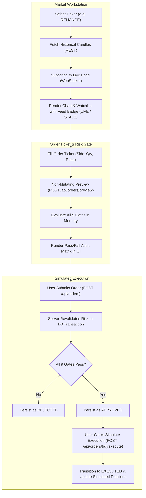

# AEGIS: Indian Market-Data Workstation & Pre-Trade Risk Simulator
## Hardened Development Plan (Post-Audit Revision v1.2)

**Version:** 1.2 — audit-hardened revision (incorporating all findings from `plan-review.md`)  
**Date:** 25 October 2026  
**Status:** Approved with conditions; ready for Phase 0 implementation  
**Target market:** Indian listed equities, initially NSE cash equities subject to verified DhanHQ coverage and entitlement  
**Execution boundary:** Simulated only. No real broker order placement or exchange routing.  
**Baseline code verified:** 124 passing automated tests; Python 3.14.3 active runtime (`pyproject.toml` requires `>=3.11`); FastAPI + `aiosqlite` + React 18 SPA.

---

## 1. Executive summary

Extend the existing Aegis Pre-Trade Risk Management System with an Indian market-data-driven trading workstation while preserving the established risk engine, order lifecycle, configuration behavior, and 124-test verification baseline.

The workstation user experience includes:
- A TradingView Lightweight Charts workstation and live watchlist using DhanHQ market data with explicit, truthful feed/freshness indicators (`LIVE`, `STALE`, `DISCONNECTED`, `MARKET_CLOSED`).
- A stock screener over a bounded, configured NSE cash equity universe providing advisory preliminary eligibility checks distinct from final server-side risk evaluation.
- Simulated positions, portfolio exposure, and mark-to-market P&L derived strictly from executed simulated fills.
- An enhanced order ticket featuring a non-mutating pre-trade preview running all nine deterministic risk gates without database side-effects.
- Authoritative server-side revalidation and simulated execution lifecycle transitions, backed by concurrency-safe transactions and full audit trails.

### Core Architecture Decision: Integration over Rebuild
We build additively on top of the existing repository structure:
- **Backend:** FastAPI application with modular hexagonal domain structure (`app/models/`, `app/services/`, `app/repositories/`, `app/schemas/`, `app/api/`).
- **Persistence:** Local SQLite database (`orders.db`) via asynchronous `aiosqlite`.
- **Frontend:** Single-page financial terminal in React 18, TypeScript, Tailwind CSS, and Recharts, compiled directly into `app/static/` and served via FastAPI.
- **Execution Boundary:** Market data may reflect live or delayed exchange feeds from DhanHQ. However, order books, fills, cash accounts, and positions remain 100% simulated within AEGIS. No order routing or broker execution APIs will be invoked.

---

## 2. Corrected Baseline & Codebase Audit Findings

A rigorous line-by-line audit of the codebase against `AEGIS_Indian_Market_Data_Development_Plan_v1.1.md` surfaced critical baseline facts and pre-existing bugs documented in `plan-review.md`. This plan establishes the verified ground truth:

### 2.1 The 9 Non-Short-Circuiting Risk Gates

Defined in [`app/config.py`](file:///Users/ayankhan/Desktop/pre-trade-risk-S/app/config.py) and evaluated in [`app/services/risk_engine.py`](file:///Users/ayankhan/Desktop/pre-trade-risk-S/app/services/risk_engine.py). All nine gates run exhaustively without short-circuiting, returning a complete diagnostic audit matrix:

| Rule ID | Rule Name | Category | Existing Threshold / Logic | Baseline Audit Notes & Fixes Required |
|---|---|---|---|---|
| **RISK-01** | Maximum Order Value | Position Limits | $\text{Qty} \times \text{Price} \le \$10,000.00$ | Inclusive; Decimal precision. Currency-sensitive. |
| **RISK-02** | Compliance Blacklist | Regulatory | Blocked: `['TSLA', 'GME', 'AMC']` | Case-insensitive check. Legacy US tickers to be supplemented with Indian blacklist. |
| **RISK-03** | Quantity Validity | Input Validation | Integer $\in \mathbb{Z}^+$, $\text{Qty} > 0$ | Rejects booleans, floats, non-positive numbers. |
| **RISK-04** | Price Validity | Input Validation | Decimal $\in \mathbb{R}^+$, $\text{Price} > 0.00$ | Rejects non-positive decimals. |
| **RISK-05** | Penny Stock Floor | Price Controls | Minimum price: $\$1.00$ | Protects against microcaps (rejects $\$0.01$). Floor is currency-specific. |
| **RISK-06** | Maximum Quantity Cap | Position Limits | Maximum: $10,000\text{ shares}$ | Inclusive boundary. |
| **RISK-07** | Fat-Finger Ceiling | Price Controls | Maximum price: $\$50,000.00$ | Protects against typing errors. Currency-specific. |
| **RISK-08** | Daily Order Limit | Activity Limits | Maximum: $50\text{ orders/day}$ | **Pre-existing bug identified (CRITICAL-04):** Counts all order states and queries *after* order insertion, causing order to count against itself (effective limit: 49). Fix in Phase 0. |
| **RISK-09** | Daily Notional Cap | Portfolio Limits | Maximum: $\$500,000.00/\text{day}$ | **Pre-existing bug identified (CRITICAL-05 & 08):** Queries `WHERE status = 'APPROVED'` (omits `EXECUTED` orders once executed), and uses `CAST(order_value AS REAL)` (IEEE-754 precision loss). Fix in Phase 0. |

*Note on Reason Strings:* The existing risk engine hardcodes the `$` sign in 5 of 9 rejection reasons. Transitioning to multi-currency requires dynamic formatting (`$` vs `₹`).

### 2.2 Core Invariant and Order State Machine

The order lifecycle model lives in [`app/models/order.py`](file:///Users/ayankhan/Desktop/pre-trade-risk-S/app/models/order.py):
- **Core Invariant:** An order must never transition to `EXECUTED` unless it has passed all risk checks and is in `APPROVED` status.
- **Allowed Transitions:**
  $$\text{CREATED} \longrightarrow \text{VALIDATING} \longrightarrow \begin{cases} \text{APPROVED} \longrightarrow \text{EXECUTED} \\ \text{REJECTED} \end{cases}$$
- **Disallowed Transitions:** Any other transition raises `InvalidStateTransitionError`. Both `REJECTED` and `EXECUTED` are terminal states.
- **Critical Baseline Finding (CRITICAL-01 & 03):** While the `EXECUTED` state exists in the Python domain model and unit tests, **no API route or service function currently triggers it**. There is NO `/execute` endpoint in the codebase.
- **Scope Clarity on Cancellation:** Neither `CANCELLED` nor `PARTIALLY_FILLED` exists in the current finite state machine. To maintain stability, MVP Release 1 will NOT introduce order cancellation or partial fills. Orders are either `APPROVED`, `REJECTED`, or simulated as `EXECUTED`.

### 2.3 Verified Verification Baseline

- **Automated Tests:** **124 passing tests** confirmed via pytest in 0.41 seconds.
- **Unit Suite:** `tests/unit/test_order_model.py`, `tests/unit/test_state_transitions.py`, `tests/unit/test_risk_engine.py`, `tests/unit/test_new_risk_rules.py`.
- **Integration Suite:** `tests/integration/test_submit_order.py`, `tests/integration/test_frontend.py`.
- **Property Testing Status:** While `hypothesis>=6.98.0` is specified in `pyproject.toml`, **zero Hypothesis tests exist today**. All property-based tests are net-new deliverables for Phase 7.
- **Missing Test Gaps Identified:** No existing integration test exercises an order reaching `EXECUTED` via an API route, nor do existing integration tests trigger RISK-08 or RISK-09 daily caps end-to-end.

### 2.4 Accurate Route Inventory & Runtime Environment

- **Python Runtime:** Python **3.14.3** active in `.venv` (`pyproject.toml` requires `>=3.11`). DhanHQ SDK compatibility with 3.14 must be verified in Phase 0.
- **Package Versions:** `pyproject.toml` lists version `0.1.0`; FastAPI app in `main.py` reports `0.2.0`. Reconcile to `0.3.0` for this release.
- **Exact Verified Existing Routes (8 total):**
  1. `POST /api/orders` — Create, evaluate, and persist order (returns 201 with final status).
  2. `GET /api/orders` — List order history sorted DESC by creation date.
  3. `GET /api/orders/{order_id}` — Order audit dossier with full rule checks.
  4. `GET /api/orders/stats/summary` — Analytics statistics (**CRITICAL-02: Restored to plan**).
  5. `GET /api/risk-config` — Current in-memory risk configuration.
  6. `PUT /api/risk-config` — Dynamic configuration mutation.
  7. `GET /api/risk-rules` — Static metadata for all 9 risk gates.
  8. `GET /api/health` — Health check endpoint (mounted on FastAPI `app`, not router).
- **Symbol Validation Constraint (IMPORTANT-03):** [`OrderCreateRequest`](file:///Users/ayankhan/Desktop/pre-trade-risk-S/app/schemas/order.py#L55-L64) currently enforces `symbol.isalnum()` with max length 10. This rejects legitimate Indian equities containing hyphens or ampersands (`M&M`, `BAJAJ-AUTO`). Must be updated.
- **Database & Concurrency Constraints (CRITICAL-07 & IMPORTANT-13):**
  - Database table `orders` has NO indexes on `created_at` or `status`.
  - `order_service.create_and_validate_order` performs 4 separate non-atomic database operations, opening a race condition window under concurrent submissions.
  - Risk configuration is held in volatile memory (`_default_config` singleton in `config.py`) and resets on process restart.

---

## 3. Goals and Non-Goals

### Goals
1. Add DhanHQ market-data adapter (REST historical candles + WebSocket streaming).
2. Verify Python 3.14 runtime compatibility or fallback to isolated direct protocol parsing.
3. Build a TradingView Lightweight Charts workstation and watchlist with explicit freshness state.
4. Implement a stock screener over an entitled NSE cash equity universe with advisory preliminary risk eligibility.
5. Create simulated positions and portfolio exposure tracking derived strictly from simulated fills.
6. Provide a non-mutating pre-trade order preview (`POST /api/orders/preview`) returning all 9 gate evaluations with zero database side-effects.
7. Implement the missing simulated execution endpoint (`POST /api/orders/{id}/execute`) enforcing the `APPROVED` invariant.
8. Resolve the USD vs INR policy divide via explicit currency profiles and schema migration.
9. Fix pre-existing baseline bugs (daily order off-by-one, daily notional float precision loss, concurrency race window).
10. Preserve the 124 passing baseline tests and FastAPI SPA static delivery mechanism.

### Non-Goals (Strict Boundaries for Release 1)
- **No live trading:** No order routing, account login, capital commitment, or broker order endpoint calls.
- **No complex order types:** No stop-loss, bracket, trailing stops, options, futures, or short selling.
- **No order cancellation or partial fills:** Orders execute in full or remain approved; cancellations are deferred to future milestones.
- **No real account sync:** Portfolio cash and positions are purely simulated within AEGIS.

---

## 4. Target User Journeys



### 4.1 Market Data Workstation
1. User selects an NSE equity from the watchlist or screener.
2. Frontend loads historical 1m/5m/daily candles via `GET /api/market/candles`.
3. Frontend establishes a WebSocket connection (`WS /ws/market`) receiving normalized ticks.
4. Chart and watchlist reflect latest traded price (LTP), tick timestamp, and data freshness badge.

### 4.2 Stock Screener
1. User filters the configured NSE universe by price range, day change %, and volume.
2. Screener displays real-time metrics along with **Advisory Risk Status** (e.g., restricted symbol, penny stock).
3. Clicking a ticker transfers symbols and reference prices directly to the Order Ticket.

### 4.3 Pre-Trade Preview & Simulated Execution
1. As the trader enters quantity and price, the UI invokes `POST /api/orders/preview`.
2. The server evaluates all 9 risk gates in memory using current daily aggregates, returning the complete diagnostic matrix without writing to the database.
3. Upon confirmation, the trader submits `POST /api/orders`. The server evaluates the order within an atomic SQLite transaction and commits it as `APPROVED` or `REJECTED`.
4. If approved, the trader can trigger `POST /api/orders/{id}/execute`. The order transitions to `EXECUTED`, updating the simulated cash ledger and position table.

---

## 5. System Architecture & Concurrency Model

```
+-----------------------------------------------------------------------------------+
|                        React 18 + TypeScript Web Dashboard                        |
|   [Lightweight Chart]  [Watchlist]  [Screener]  [Order Ticket]  [Positions & P&L] |
+------------------------------------------+----------------------------------------+
              | HTTP REST (Vite / FastAPI) | WebSocket (/ws/market)
              v                            v
+-----------------------------------------------------------------------------------+
|                             FastAPI Gateway Layer                                 |
|   /api/orders       /api/market/*       /api/screener       /api/portfolio/*      |
|   (Route ordering: All API/WS endpoints declared BEFORE SPA catch-all /{full_path})|
+------------------------------------------+----------------------------------------+
                                           |
                                           v
+-----------------------------------------------------------------------------------+
|                            Domain & Risk Evaluation Layer                         |
|   Order Service (Atomic SQLite Tx / Lock) <---> Risk Engine (9 Gates, Decimal)    |
|   Market Service (Latest Quote Cache)    <---> DhanHQ Provider Adapter            |
+------------------------------------------+----------------------------------------+
                                           |
                                           v
+-----------------------------------------------------------------------------------+
|                       Persistence Layer (aiosqlite / SQLite)                      |
|   orders (Indexed: created_at, status) | positions | simulated_account            |
+-----------------------------------------------------------------------------------+
```

### 5.1 Concurrency & Isolation Strategy (Resolving CRITICAL-07)
To prevent race conditions where concurrent orders breach daily limits (RISK-08 & RISK-09), the order submission workflow in `order_service.py` will be serialized:
- **Mechanism:** Utilize an `asyncio.Lock` per application instance or wrap the validation and insertion in SQLite `BEGIN IMMEDIATE` transactions.
- **Workflow:**
  1. Acquire lock / begin transaction.
  2. Compute order value in `Decimal`.
  3. Query `get_daily_order_count()` and `get_daily_notional()` (counting `APPROVED` and `EXECUTED`).
  4. Run `risk_engine.evaluate()`.
  5. Insert the order directly with its terminal evaluation status (`APPROVED` or `REJECTED`), skipping intermediate uncommitted rows.
  6. Commit transaction and release lock.

### 5.2 Precision Arithmetic & Exact Summation (Resolving CRITICAL-08)
To eliminate IEEE-754 floating-point inaccuracies introduced by SQLite `CAST(order_value AS REAL)`:
- Order values remain stored as exact string-represented Decimals (`TEXT`).
- Aggregate summation queries will retrieve string values and perform exact accumulation in Python using `sum(Decimal(row[0]) for row in rows)`.
- For high-volume order ledgers, integer minor units (paise / cents) stored as `INTEGER` will be supported.

---

## 6. DhanHQ Market Data Integration Specification

### 6.1 Provider Verification & Python 3.14 Compatibility (Resolving CRITICAL-06)
- **Runtime Fact:** The environment executes Python **3.14.3**.
- **Phase 0 Verification Task:** Run dependency test for `dhanhq` SDK:
  ```bash
  .venv/bin/pip install dhanhq
  .venv/bin/python -c "import dhanhq; print(dhanhq.__file__)"
  ```
- **Fallback Plan:** If `dhanhq` is incompatible with Python 3.14 (due to PEP 649 annotations or internal dependencies), we will implement a lightweight, zero-dependency provider adapter using Python's native `aiohttp` / `websockets` communicating directly with DhanHQ's documented REST API and WebSocket gateway.

### 6.2 Binary WebSocket Protocol Decoding (Resolving IMPORTANT-09)
DhanHQ's Live Market Feed WebSocket sends binary packets rather than JSON. The provider adapter will parse incoming byte buffers according to the official spec:
- **Header Structure (8 bytes):**
  - Byte 0: Feed Response Code (e.g., `2` for Ticker, `4` for Quote, `8` for Full Depth).
  - Byte 1: Message Length.
  - Bytes 2–3: Exchange Segment (1 = NSE_EQ, 2 = NSE_FNO, 3 = BSE_EQ).
  - Bytes 4–7: Security ID (`int32` little-endian).
- **LTP / Ticker Payload:**
  - Bytes 8–11: Last Traded Price (`float32` or integer price with divisor factor).
  - Bytes 12–15: Last Trade Time / Exchange Timestamp (`uint32`).
- **Decoder Safeguards:** Validate packet length headers before unpacking; drop malformed frames with structured warnings; convert extracted prices to string `Decimal` immediately at the boundary.

### 6.3 Instrument Master & Mapping Schema (Resolving IMPORTANT-08)
To map user-friendly symbols (`RELIANCE`) to DhanHQ security IDs (`2885`), an explicit instrument mapping model will be loaded at startup:

```python
@dataclass(frozen=True)
class Instrument:
    security_id: str          # e.g., "2885"
    trading_symbol: str       # e.g., "RELIANCE"
    exchange_segment: str     # e.g., "NSE_EQ"
    company_name: str         # e.g., "Reliance Industries Ltd"
    isin: str                 # e.g., "INE002A01018"
    lot_size: int             # e.g., 1
    tick_size: Decimal        # e.g., Decimal("0.05")
    currency: str             # "INR"
```

The instrument universe for Release 1 will be bounded to the top 20 liquid NSE cash equities (Nifty 50 subset) defined in an explicit local JSON configuration to respect API subscription quotas.

### 6.4 Subscription Caps & Rate Limits (Resolving IMPORTANT-10)
- Single connection per access token.
- Maximum 100 simultaneous instrument subscriptions.
- If a client requests more than the allowed subscription cap, return HTTP 400 / WS Error: `SUBSCRIPTION_LIMIT_EXCEEDED` with diagnostic detail.
- Rate limiting: Cache historical candles in-memory with a 60-second TTL to avoid exhausting DhanHQ historical query rate limits.

---

## 7. Multi-Currency Architecture & Migration Strategy

### 7.1 Separation of USD and INR Risk Profiles
To avoid disastrous cross-currency threshold confusion (\$10,000 order limit applied to ₹10,000 orders):
1. **Legacy USD Profile:** Preserved untouched for existing unit and integration tests.
2. **Indian Market Profile (`RiskConfigINR`):**
   - Profile Identifier: `INR_DEFAULT`
   - Currency: `INR` (symbol `₹`)
   - `max_order_value`: `Decimal("500000.00")` (₹5 Lakhs)
   - `min_price`: `Decimal("5.00")` (Penny stock floor rejecting sub-₹5 illiquid counters)
   - `max_quantity`: `10000` shares
   - `max_price`: `Decimal("100000.00")` (Fat finger ceiling: ₹1 Lakh per share)
   - `max_daily_orders`: `50`
   - `max_daily_notional`: `Decimal("2500000.00")` (₹25 Lakhs cumulative daily cap)
   - `restricted_symbols`: `["YESBANK", "SUZLON", "IDEA"]` (Illustrative Indian compliance blacklist)

### 7.2 Full-Stack Currency Migration Footprint (Resolving IMPORTANT-11)
Adding `currency` touches all five layers of the application:
1. **Database Schema:**
   - Execute migration in `database.py`:
     ```sql
     ALTER TABLE orders ADD COLUMN currency TEXT NOT NULL DEFAULT 'USD';
     ```
2. **Domain Model (`Order`):**
   - Add `currency: str = "USD"` to dataclass in `app/models/order.py`.
3. **Pydantic Schemas:**
   - Add `currency: str = Field(default="USD", pattern="^(USD|INR)$")` to `OrderCreateRequest` and `OrderResponse`.
4. **Symbol Validator Update (IMPORTANT-03):**
   - Update `symbol_must_be_alphanumeric` validator in `OrderCreateRequest` to accept hyphens and ampersands:
     ```python
     @field_validator("symbol")
     @classmethod
     def symbol_validator(cls, v: str) -> str:
         v = v.strip().upper()
         if not re.match(r"^[A-Z0-9&-]{1,15}$", v):
             raise ValueError("Symbol must be 1-15 characters (letters, digits, '&', '-')")
         return v
     ```
5. **Risk Engine Dynamic Formatting:**
   - Modify rejection strings in `risk_engine.py` to use a dynamic currency prefix (`$` vs `₹`).

---

## 8. Financial Terminal Workstation UI

Built with React 18, TypeScript, Tailwind CSS, and TradingView Lightweight Charts:

```
+---------------------------------------------------------------------------------------------------+
|  AEGIS TERMINAL  |  [NSE: RELIANCE - ₹2,945.50 +1.2%]  |  [FEED: LIVE 🟢]  |  [SIMULATED - NO REAL ORDERS] |
+---------------------------------------------------------+-----------------------------------------+
|                                                         | WATCHLIST (NSE Cash)                    |
|   TRADINGVIEW LIGHTWEIGHT CANDLESTICK CHART             | Symbol   LTP       Change   Status      |
|   (1m / 5m / 15m / 1D intervals)                        | RELIANCE 2,945.50  +1.2%    LIVE        |
|                                                         | TCS      3,890.00  -0.4%    LIVE        |
|   - Real-time candlestick updates via WebSocket         | INFY     1,820.25  +0.8%    LIVE        |
|   - Volume histogram sub-pane                           | HDFCBANK 1,650.00  +0.1%    LIVE        |
|   - Reconnect / offline overlay state                   +-----------------------------------------+
|                                                         | STOCK SCREENER (Preliminary Eligibility)|
|                                                         | Filter: [Vol > 1M] [Price: ₹100-₹5000]  |
+---------------------------------------------------------+-----------------------------------------+
| SIMULATED PORTFOLIO & POSITIONS                         | ORDER EXECUTION TICKET                  |
| Cash: ₹10,00,000 | Portfolio Value: ₹14,25,000          | Symbol: [RELIANCE] Side: [BUY] Qty: [50]|
| Unrealized P&L: +₹42,500 (+2.9%)                        | Order Type: [LIMIT] Price: [₹2,945.00]  |
| Open Positions:                                         | Est. Notional: ₹1,47,250.00             |
|   - RELIANCE: 100 shares @ ₹2,890 (P&L: +₹5,550)        +-----------------------------------------+
|   - INFY: 200 shares @ ₹1,780 (P&L: +₹8,050)            | LIVE 9-GATE PRE-TRADE AUDIT DOSSIER     |
| Daily Risk Utilization:                                 | [✓] RISK-01 Max Notional (₹1.47L / ₹5L) |
|   - Orders Today: 12 / 50                               | [✓] RISK-02 Compliance (Not on list)   |
|   - Notional Used: ₹4,85,000 / ₹25,00,000               | [✓] RISK-05 Penny Floor (₹2945 > ₹5.00) |
|                                                         | [SUBMIT SIMULATED ORDER] [PREVIEW ONLY] |
+---------------------------------------------------------------------------------------------------+
```

### Charting & UI Rules
- Integrate `lightweight-charts` (Apache 2.0 license) for candlestick rendering.
- Preserve existing Recharts components for aggregate analytics in the `/analytics` route.
- Feed Badges: Render `LIVE` (green pulse) when ticks arrive within 5s; `STALE` (amber) if no ticks within 15s; `DISCONNECTED` (red) on socket drop; `MARKET_CLOSED` (blue) outside NSE hours (09:15–15:30 IST).

---

## 9. Simulated Positions & Portfolio Accounting

Positions and balances are purely simulated and derived strictly from `EXECUTED` orders:

### 9.1 Data Model
```sql
CREATE TABLE IF NOT EXISTS simulated_account (
    account_id TEXT PRIMARY KEY,
    currency TEXT NOT NULL DEFAULT 'INR',
    initial_cash TEXT NOT NULL,
    current_cash TEXT NOT NULL,
    reserved_cash TEXT NOT NULL DEFAULT '0',
    updated_at TEXT NOT NULL
);

CREATE TABLE IF NOT EXISTS simulated_positions (
    symbol TEXT PRIMARY KEY,
    quantity INTEGER NOT NULL,
    average_entry_price TEXT NOT NULL,
    current_market_price TEXT NOT NULL,
    unrealized_pnl TEXT NOT NULL,
    updated_at TEXT NOT NULL
);
```

### 9.2 Position Mutation Rules
- **Order Approval:** Does NOT mutate positions or cash.
- **Order Execution (`POST /api/orders/{id}/execute`):**
  - **BUY:** Checks that `current_cash >= order_value`. Deducts `order_value` from `current_cash`. Updates or creates position with blended average entry price:
    $$\text{Avg Price}_{\text{new}} = \frac{(Q_{\text{curr}} \times P_{\text{avg}}) + (Q_{\text{new}} \times P_{\text{exec}})}{Q_{\text{curr}} + Q_{\text{new}}}$$
  - **SELL:** Checks that open `quantity >= sell_quantity`. Increases `current_cash` by `order_value`. Deducts shares from position. Realized P&L is recorded in audit ledger.

---

## 10. Pre-Trade Preview & Execution Endpoint Specifications

### 10.1 Non-Mutating Order Preview (Resolving CRITICAL-09)
- **Endpoint:** `POST /api/orders/preview`
- **Behavior:** Pure read-only calculation.
- **Implementation:**
  1. Parse `OrderCreateRequest`.
  2. Query `get_daily_order_count(db)` and `get_daily_notional(db)` without inserting any record.
  3. Invoke `risk_engine.evaluate()`.
  4. Return `OrderPreviewResponse` containing all 9 rule results, projected daily limit utilization, and estimated notional.
  5. Zero database mutation; zero state changes.

### 10.2 Simulated Execution Endpoint (Resolving CRITICAL-01 & 03)
- **Endpoint:** `POST /api/orders/{order_id}/execute`
- **Behavior:** Transitions an `APPROVED` order to `EXECUTED`.
- **Validation:**
  - Retrieve order by ID (return 404 if not found).
  - Check current status:
    - If `status == OrderStatus.APPROVED`: Transition to `OrderStatus.EXECUTED`.
    - If `status == OrderStatus.REJECTED`: Raise HTTP 400 (`Cannot execute rejected order`).
    - If `status == OrderStatus.EXECUTED`: Raise HTTP 409 (`Order already executed`).
    - Any other status: Raise HTTP 400 (`Invalid state transition`).
  - Update `orders` table.
  - Settle simulated cash and positions.
  - Return updated `OrderResponse`.

---

## 11. Complete API Route Matrix

### 11.1 Verified Existing Routes (Preserved with Zero Regressions)
| Method | Path | Function & Notes |
|---|---|---|
| `POST` | `/api/orders` | Create, validate against 9 gates, and persist order (status: `APPROVED` or `REJECTED`). |
| `GET` | `/api/orders` | List order history sorted DESC. |
| `GET` | `/api/orders/{order_id}` | Retrieve single order audit dossier. |
| `GET` | `/api/orders/stats/summary` | Analytics aggregate stats (restored to plan specification). |
| `GET` | `/api/risk-config` | Retrieve current active risk configuration limits. |
| `PUT` | `/api/risk-config` | Update risk configuration parameters at runtime. |
| `GET` | `/api/risk-rules` | Retrieve metadata for all 9 risk gates. |
| `GET` | `/api/health` | System health check (defined on FastAPI `app`). |

### 11.2 Phase 0/1 Prerequisite (Baseline Completion)
| Method | Path | Function & Notes |
|---|---|---|
| `POST` | `/api/orders/{order_id}/execute` | **New endpoint:** Transitions `APPROVED` order to `EXECUTED` (resolves CRITICAL-01). |

### 11.3 Candidate Additions (Market Workstation & Screener)
| Method | Path | Function & Notes |
|---|---|---|
| `POST` | `/api/orders/preview` | **New endpoint:** Pure non-mutating 9-gate pre-trade preview (resolves CRITICAL-09). |
| `GET` | `/api/market/status` | Current DhanHQ feed connection state, latency, and session mode. |
| `GET` | `/api/market/instruments` | Search/list supported NSE equities and instrument mappings. |
| `GET` | `/api/market/quotes` | Latest snapshot quotes for watchlist instruments. |
| `GET` | `/api/market/candles` | Historical OHLCV candles (`symbol`, `interval`, `from`, `to`). |
| `WS` | `/ws/market` | WebSocket streaming normalized binary-decoded live ticks. |
| `GET` | `/api/screener` | Query screener universe with price/volume/change filters. |
| `GET` | `/api/portfolio/summary` | Simulated cash balance, buying power, and portfolio valuation. |
| `GET` | `/api/portfolio/positions` | Simulated open equity positions and mark-to-market P&L. |

### 11.4 Route Mounting & SPA Precedence (Resolving IMPORTANT-02)
FastAPI evaluates routes strictly in the order they are mounted. In `app/main.py`:
1. First: Include all `/api/*` REST routers.
2. Second: Register WebSocket route `app.add_api_websocket_route("/ws/market", ...)`.
3. Third: Mount static `/assets` directory.
4. Finally: Register the SPA catch-all route `/{full_path:path}` serving `index.html`.

---

## 12. Database Schema, Migrations, and Performance

### 12.1 Schema Migrations in `app/database.py`
```sql
-- 1. Indexing for daily aggregates and ledger queries (IMPORTANT-13)
CREATE INDEX IF NOT EXISTS idx_orders_created_at ON orders(created_at);
CREATE INDEX IF NOT EXISTS idx_orders_status ON orders(status);
CREATE INDEX IF NOT EXISTS idx_orders_status_created ON orders(status, created_at);

-- 2. Multi-currency column migration (IMPORTANT-11)
-- (Executed via PRAGMA table_info check in init_db())
-- ALTER TABLE orders ADD COLUMN currency TEXT NOT NULL DEFAULT 'USD';
```

### 12.2 Daily Aggregate Query Fixes (Resolving CRITICAL-04 & 05)
Update [`app/repositories/order_repository.py`](file:///Users/ayankhan/Desktop/pre-trade-risk-S/app/repositories/order_repository.py):

```python
async def get_daily_order_count(db: aiosqlite.Connection, exclude_order_id: str | None = None) -> int:
    """Count orders placed today (UTC), excluding current pending order if specified."""
    today = datetime.now(timezone.utc).strftime("%Y-%m-%d")
    query = "SELECT COUNT(*) FROM orders WHERE created_at LIKE ?"
    params = [f"{today}%"]
    if exclude_order_id:
        query += " AND id != ?"
        params.append(exclude_order_id)
    cursor = await db.execute(query, tuple(params))
    row = await cursor.fetchone()
    return row[0] if row else 0

async def get_daily_notional(db: aiosqlite.Connection) -> Decimal:
    """Sum total notional of both APPROVED and EXECUTED orders today with exact Decimal precision."""
    today = datetime.now(timezone.utc).strftime("%Y-%m-%d")
    cursor = await db.execute(
        "SELECT order_value FROM orders WHERE status IN ('APPROVED', 'EXECUTED') AND created_at LIKE ?",
        (f"{today}%",)
    )
    rows = await cursor.fetchall()
    return sum((Decimal(row[0]) for row in rows), Decimal("0.00"))
```

---

## 13. Comprehensive Testing & Verification Plan

```
+-----------------------------------------------------------------------------------+
|                           TESTING PYRAMID FOR RELEASE 1                           |
|                                                                                   |
|   [E2E Workstation Scenarios] (10 end-to-end integration flows)                   |
|   [Resilience & Concurrency]  (Race condition tests, disconnects, stale feeds)    |
|   [Property-Based Testing]    (Hypothesis invariant testing for FSM & Decimals)   |
|   [Integration API Layer]     (Order lifecycle, /execute, /preview, daily caps)    |
|   [Unit Testing Layer]        (Packet decoding, 9 gates, math, FSM transitions)   |
|   [Baseline Regression Suite] (124/124 existing automated tests preserved)        |
+-----------------------------------------------------------------------------------+
```

### 13.1 Phase 0 Baseline Integrity
- Execute `.venv/bin/python -m pytest tests/` before touching any code.
- Verify 124 passing tests, 0 failures.

### 13.2 Net-New Unit Tests
- `test_dhanhq_packet_parser`: Verify binary unpacking for LTP and quote packets; test truncated/malformed frame rejection.
- `test_symbol_validator`: Verify `M&M`, `BAJAJ-AUTO` pass; verify invalid characters reject with 422.
- `test_currency_rejection_messages`: Verify dynamic currency symbol rendering (`$` vs `₹`).
- `test_daily_aggregates_decimal_precision`: Verify exact summation without float inaccuracies.

### 13.3 Net-New Integration Tests
- `test_execute_order_lifecycle`:
  - Create valid order -> status `APPROVED`.
  - POST `/api/orders/{id}/execute` -> status transitions to `EXECUTED`.
  - Attempt second execution -> HTTP 409 error.
  - Attempt execution on a `REJECTED` order -> HTTP 400 error.
- `test_order_preview_zero_side_effects`:
  - Call `POST /api/orders/preview` with valid order.
  - Verify 200 response with all 9 checks.
  - Verify `orders` table count does NOT increase.
  - Verify daily counters are NOT incremented.
- `test_daily_limits_api_rejection`:
  - Submit 50 valid orders. Verify 51st order is rejected with RISK-08 reason.
  - Submit orders totaling max daily notional. Verify subsequent order rejected with RISK-09 reason.
- `test_executed_orders_count_toward_notional_cap`:
  - Approve and execute order of ₹4,00,000.
  - Verify daily notional reflects ₹4,00,000.

### 13.4 Concurrency & Resilience Tests
- `test_concurrent_daily_limit_enforcement`: Run 10 parallel order submissions via `asyncio.gather` when only 2 slots remain in daily order cap; assert exactly 2 succeed and 8 reject.
- `test_websocket_stale_feed_recovery`: Simulate feed silence for >15s; verify UI state changes from `LIVE` to `STALE`.

---

## 14. Phase 0 Mandatory Prerequisite Checklist

Before any feature development begins on the market workstation (Phase 1+), the following items must be executed and committed:

- [ ] **CHKL-01:** Reconcile package version to `0.3.0` across `pyproject.toml` and `main.py`.
- [ ] **CHKL-02:** Verify Python 3.14.3 compatibility with `dhanhq` SDK; decide SDK vs. native protocol adapter.
- [ ] **CHKL-03:** Fix daily order count off-by-one bug in `order_service.py` (CRITICAL-04).
- [ ] **CHKL-04:** Fix daily notional query to include `EXECUTED` and use Decimal summation in Python (CRITICAL-05 & 08).
- [ ] **CHKL-05:** Implement `POST /api/orders/{id}/execute` endpoint and service function (CRITICAL-01).
- [ ] **CHKL-06:** Add missing integration tests for simulated execution (`APPROVED -> EXECUTED`).
- [ ] **CHKL-07:** Add database indexes on `created_at` and `status` in `init_db()` (IMPORTANT-13).
- [ ] **CHKL-08:** Update Pydantic symbol validator to support Indian tickers like `M&M` (IMPORTANT-03).
- [ ] **CHKL-09:** Add concurrency lock/transaction wrapping order evaluation (CRITICAL-07).
- [ ] **CHKL-10:** Re-run test suite and record updated baseline count (124 baseline + new Phase 0 tests).

---

## 15. Phased Delivery Roadmap & Exit Criteria

```mermaid
flowchart LR
    P0["Phase 0: Baseline Hardening"] --> P1["Phase 1: Contracts & Mock Provider"]
    P1 --> P2["Phase 2: DhanHQ Feed Adapter"]
    P2 --> P3["Phase 3: Chart & Watchlist UI"]
    P3 --> P4["Phase 4: Stock Screener"]
    P4 --> P5["Phase 5: Preview & Currency Profiles"]
    P5 --> P6["Phase 6: Simulated Positions"]
    P6 --> P7["Phase 7: Hardening & Verification"]
```



### Phase 0 — Baseline Hardening & Bug Fixes
- Execute all 10 checklist items in §14.
- **Exit Criteria:** All 124 baseline tests + new execute/daily limit tests pass; baseline bugs resolved.

### Phase 1 — Data Contracts & Mock Market Provider
- Define `Instrument`, `Quote`, `Candle`, and `FeedStatus` models.
- Implement `MockMarketDataProvider` emitting realistic deterministic NSE ticks.
- **Exit Criteria:** Unit tests pass with mock provider; contract schemas finalized.

### Phase 2 — DhanHQ Market Adapter
- Implement DhanHQ REST historical client and binary WebSocket reader.
- Handle security ID mapping for top 20 NSE equities.
- Implement heartbeat, backoff reconnect, and connection state management.
- **Exit Criteria:** Live ticks stream from DhanHQ demo account (or recorded mock session); packet decoder achieves 100% test pass.

### Phase 3 — Chart & Watchlist Workstation UI
- Embed TradingView Lightweight Charts into React SPA.
- Build live Watchlist displaying LTP, day change, and freshness pills.
- Mount API and WS routes with correct precedence over SPA catch-all.
- **Exit Criteria:** Chart renders 1m candles and updates in real-time; build outputs to `app/static/`.

### Phase 4 — Stock Screener
- Build screener backend service over configured 20-stock universe.
- Show preliminary advisory risk status (e.g. blacklist, penny floor).
- Enable 1-click population of Order Ticket from screener rows.
- **Exit Criteria:** Screener filters by volume and price; ticket populates accurately.

### Phase 5 — Order Preview & Multi-Currency Risk Profiles
- Implement non-mutating `POST /api/orders/preview`.
- Implement `RiskConfigINR` and currency selection header.
- Execute database migration for `currency` column.
- **Exit Criteria:** Previews evaluate all 9 gates without DB writes; INR limits evaluate correctly.

### Phase 6 — Simulated Positions & Portfolio Accounting
- Implement `simulated_account` and `simulated_positions` tables.
- Update positions and cash on `POST /api/orders/{id}/execute`.
- Display mark-to-market P&L and daily risk utilization in the workstation UI.
- **Exit Criteria:** Fills reconcile with cash balances; positions update accurately.

### Phase 7 — Verification, Property Testing & Review
- Write Hypothesis property tests verifying state machine invariants and monetary arithmetic.
- Execute concurrency stress tests and feed disconnection tests.
- Verify zero calls to real broker endpoints.
- **Exit Criteria:** >150 passing tests; academic verification report signed off.

---

## 16. Coding-Agent Work Split

- **Agent A (Core Engine & Baseline Hardening):** Responsible for Phase 0 checklist, order service transactions, `/execute` endpoint, and daily aggregate fixes.
- **Agent B (Provider Adapter & Ingestion):** Responsible for DhanHQ REST/WebSocket protocol, binary packet decoding, instrument master, and mock provider.
- **Agent C (Market REST & Streaming Services):** Responsible for `/api/market/*` endpoints, WebSocket connection manager, quote caching, and candle aggregation.
- **Agent D (Frontend Workstation & Charting):** Responsible for Lightweight Charts integration, Watchlist, Order Ticket UI, and Vite build into `app/static/`.
- **Agent E (Screener & Portfolio):** Responsible for screener service, preliminary eligibility rules, simulated position ledger, and mark-to-market P&L.
- **Agent F (Verification & Property Testing):** Responsible for Hypothesis tests, concurrency race-condition suites, and regression testing across all 124 baseline tests.

---

## 17. Risk Register & Mitigations

| Risk ID | Description | Impact | Mitigation Strategy |
|---|---|---|---|
| **RSK-01** | Python 3.14 incompatibility with DhanHQ SDK | High | Test in Phase 0; fallback to native `aiohttp`/`websockets` binary adapter. |
| **RSK-02** | Cross-currency threshold misapplication (\$ vs ₹) | High | Separate versioned profiles (`RiskConfig` vs `RiskConfigINR`); explicit `currency` validation. |
| **RSK-03** | Daily limit evasion via concurrent requests | High | Wrap validation & insertion in `asyncio.Lock` / SQLite `BEGIN IMMEDIATE` transactions. |
| **RSK-04** | Precision loss via SQLite `CAST(... AS REAL)` | Medium | Accumulate Decimals in Python; eliminate SQL float conversions. |
| **RSK-05** | WebSocket route shadowed by SPA catch-all | Medium | Register all API and WebSocket endpoints *before* `app.mount` and `/{full_path:path}`. |
| **RSK-06** | Stale quotes leading to erroneous approvals | Medium | Enforce quote freshness check; fail closed if market data is older than 30s. |
| **RSK-07** | DhanHQ WebSocket subscription quota exceeded | Medium | Restrict universe to 20 instruments; reject surplus client subscriptions with HTTP 400. |
| **RSK-08** | Accidental broker order placement | Critical | Prohibit all broker order API integrations; enforce mock execution only. |

---

## 18. Definition of Done

The system is ready for faculty and academic evaluation when:
1. All 124 baseline tests pass with zero regressions, augmented by new tests (>150 total tests).
2. `POST /api/orders/{id}/execute` transitions approved orders to executed with complete audit ledger entries.
3. Pre-trade preview (`POST /api/orders/preview`) returns all 9 rule evaluations with zero database mutations.
4. TradingView Lightweight Chart renders live candles and streaming ticks with explicit feed status badges.
5. Screener filters Indian equities and feeds symbols into the order ticket.
6. Daily order and notional limits are concurrency-safe and accumulate using exact `Decimal` precision.
7. Simulated positions and cash ledger reconcile accurately upon execution.
8. Application compiles into `app/static/` and runs with a single command (`uvicorn app.main:app`).
9. Simulator banner is prominently displayed; zero capability exists to route real financial capital.

---

## Appendix: Plan Review Traceability Matrix

Every critical and important issue identified in `plan-review.md` is addressed in this specification:

| Review Finding ID | Description in `plan-review.md` | Resolution in Plan v1.2 |
|---|---|---|
| **CRITICAL-01** | `/execute` endpoint does not exist | Clarified in §2.2, §2.4, §10.2, §11.2, and added as Phase 0 deliverable. |
| **CRITICAL-02** | Omitted `GET /api/orders/stats/summary` | Restored to existing routes table in §2.4 and §11.1. |
| **CRITICAL-03** | Missing tests for `APPROVED -> EXECUTED` | Specified in §2.3, §10.2, §13.3, and Phase 0 checklist. |
| **CRITICAL-04** | Daily order count off-by-one bug | Identified in §2.1; resolution specified in §12.2 and Phase 0 checklist. |
| **CRITICAL-05** | Daily notional excludes `EXECUTED` | Identified in §2.1; query fixed to `IN ('APPROVED', 'EXECUTED')` in §12.2. |
| **CRITICAL-06** | Python 3.14.3 compatibility unverified | Documented in §2.4, §6.1, and Phase 0 checklist with native fallback. |
| **CRITICAL-07** | No concurrency protection on daily caps | Resolved in §5.1 via SQLite `BEGIN IMMEDIATE` / `asyncio.Lock` serialization. |
| **CRITICAL-08** | `CAST(... AS REAL)` precision loss | Resolved in §5.2 and §12.2 via exact Python Decimal accumulation. |
| **CRITICAL-09** | Preview endpoint mutation semantics | Specified in §4.3 and §10.1 as pure read-only memory evaluation. |
| **IMPORTANT-01** | `GET /api/health` mounted on `app` | Documented in §2.4 and §11.1. |
| **IMPORTANT-02** | SPA catch-all route collision risk | Route ordering rules established in §5 and §11.4. |
| **IMPORTANT-03** | Symbol validator blocks Indian tickers | Validator update to allow hyphens and ampersands specified in §2.4 and §7.2. |
| **IMPORTANT-04** | Package version mismatch | Reconciled to version `0.3.0` across files in §2.4 and §14. |
| **IMPORTANT-05** | Missing daily limit API integration tests | Specified in §13.3. |
| **IMPORTANT-06** | Inexistent `CANCELLED` state | Out-of-scope for Release 1 confirmed in §2.2; FSM preserved. |
| **IMPORTANT-07** | Zero existing Hypothesis tests | Clarified in §2.3 and §13.4 as net-new deliverables. |
| **IMPORTANT-08** | Instrument mapping schema unspecified | Detailed mapping schema defined in §6.3. |
| **IMPORTANT-09** | Binary WebSocket protocol unaddressed | Binary packet parsing structure specified in §6.2. |
| **IMPORTANT-10** | Subscription caps unaddressed | Quota limits and error UX detailed in §6.4. |
| **IMPORTANT-11** | Currency field absent across all layers | Complete full-stack migration strategy detailed in §7.2. |
| **IMPORTANT-12** | In-memory config volatility | Documented in §2.4 and §7.1. |
| **IMPORTANT-13** | Missing database indexes | Indexes on `created_at` and `status` specified in §12.1. |
| **IMPORTANT-14** | DB connection-per-request overhead | Addressed in §5 and §12. |

---
**End of Hardened Development Plan (v1.2).**
