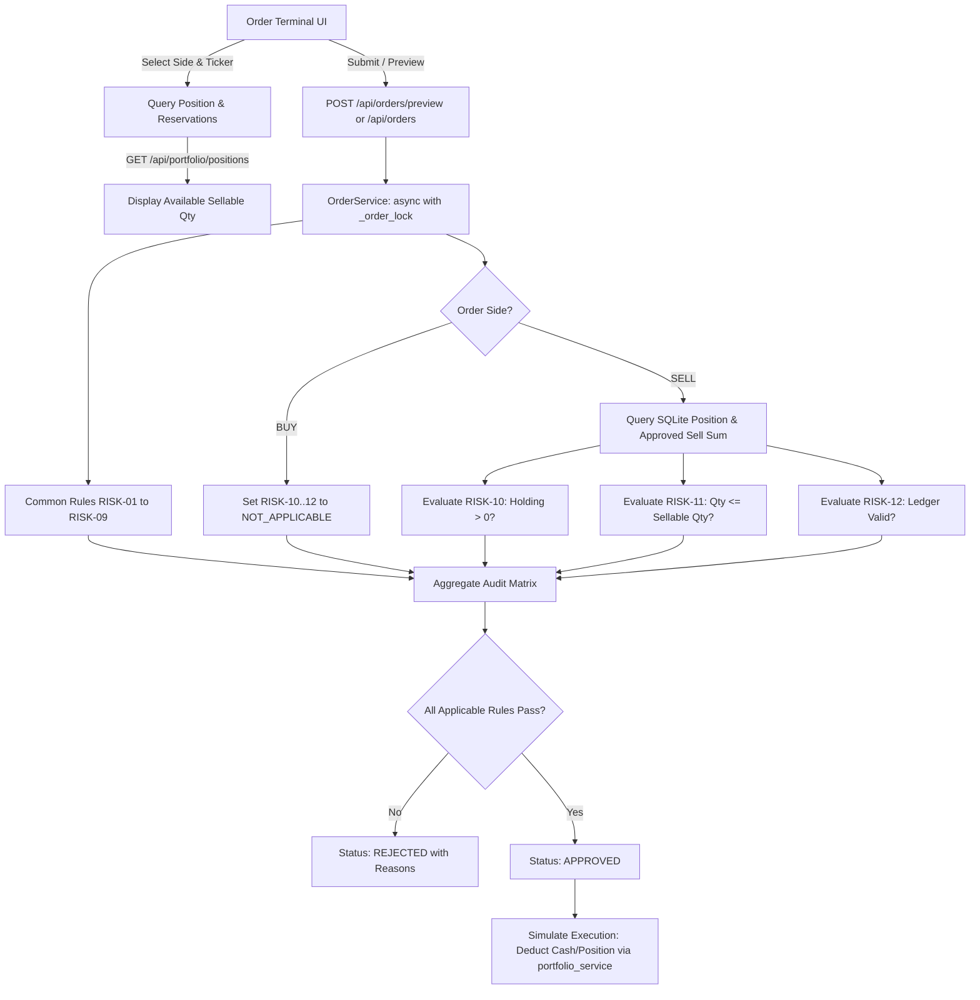

# AEGIS SELL-Side Risk Rule Implementation Plan

**Project:** AEGIS — Pre-Trade Risk Management System & Indian Market Workstation  
**Document type:** Technical Implementation Plan & Scope Specification  
**Version:** 1.1 (Updated Post-Review)  
**Date:** 25 October 2026  
**Scope:** Add authoritative SELL-side pre-trade risk validation, holding inventory checks, dynamic open-order reservations, and make the UI order-entry terminal responsive to the selected order side.  
**Execution model:** Strictly simulated orders; no real broker or exchange routing.  
**Currency Baseline:** Single Currency — Indian Rupee (INR / ₹) with NSE Cash equity universe.

---

## 1. Objective

The current AEGIS platform provides an NSE Order Entry Terminal with a BUY/SELL toggle, a real-time pre-trade risk evaluation card, a configurable Risk Rules Engine, and simulated portfolio accounting.

In the current baseline, however, the pre-trade risk engine evaluates both BUY and SELL identically against price, notional value, daily limits, and compliance blacklists, **without verifying whether the account actually holds the shares being sold**.

The objective of this plan is to make the risk engine and order lifecycle **side-aware** so that:

1. Toggling between BUY and SELL dynamically updates the applicable risk rules in real time.
2. Orders are evaluated against the specific rules applicable to the selected side.
3. SELL orders are strictly validated against available simulated portfolio holdings and open sell order reservations.
4. Short-selling is strictly prohibited under the Release 1 baseline.
5. The UI displays real-time holding telemetry: **Position Held**, **Pending Sell Reservations**, and **Net Sellable Quantity**.
6. The backend remains the sole authoritative gatekeeper for order approval and execution.
7. All 161 existing tests continue to pass with zero regressions.

---

## 2. Existing Baseline & Scope Locks

### 2.1 Current System State (v0.3.0)
- **Active Test Baseline:** **161 automated tests** passing across unit, integration, concurrency race condition tests, and property-based invariants (Hypothesis).
- **Currency & Market Universe:** Exclusively **INR (₹)** with NSE Top 20 liquid cash equities (e.g., `RELIANCE`, `TCS`, `INFY`, `HDFCBANK`).
- **Configured Thresholds:** Max order value ₹5,00,000.00, penny stock floor ₹1.00, fat-finger ceiling ₹2,00,000.00, daily count cap 50, daily notional cap ₹50,00,000.00. Compliance blacklist: `YESBANK`, `SUZLON`, `IDEA`.
- **Existing Position Ledger:** SQLite tables `simulated_account` and `simulated_positions` are active. `portfolio_service.settle_order_execution` handles execution settlement.

### 2.2 Release 1 Scope Locks (Critical)
- **Strict Finite State Machine:** Order lifecycle in Release 1 is strictly:
  $$\text{CREATED} \longrightarrow \text{VALIDATING} \longrightarrow \text{APPROVED} \longrightarrow \text{EXECUTED} \quad (\text{or } \text{REJECTED})$$
- **No Order Cancellation or Partial Fills in Release 1:** In accordance with the project roadmap, order cancellation and partial fill states (`CANCELLED`, `PARTIALLY_FILLED`) are deferred to Release 2. Reservations are held by orders in the `APPROVED` state and cleared upon `EXECUTED` (or dropped on `REJECTED`).

---

## 3. Design Principles

1. **Backend Authority:** The frontend never decides whether an order is approved. Client-side evaluation is strictly advisory and mirrored by authoritative backend evaluation.
2. **Dynamic ACID Reservations (Zero Ledger Drift):** Rather than creating duplicate reservation columns that can desynchronize, open sell reservations are computed dynamically inside the serialized database transaction:
   $$\text{Reserved Quantity} = \sum_{\substack{\text{status} = \text{'APPROVED'} \\ \text{side} = \text{'SELL'}}} \text{quantity}$$
   $$\text{Sellable Quantity} = \text{Current Position Quantity} - \text{Reserved Quantity}$$
3. **Fail-Closed Security:** Missing position records, database errors, or ledger inconsistencies must fail safe and reject the SELL order.
4. **Complete Diagnostics:** The non-short-circuiting design is preserved: all applicable rules are evaluated and recorded in the audit matrix, even if one or more fail.
5. **Simulated-Only Isolation:** No real exchange or broker credentials are required or contacted.

---

## 4. Rule Matrix & Side Applicability

### 4.1 Common Rules (RISK-01 to RISK-09)
All 9 baseline rules remain active and apply to both BUY and SELL:

| Rule ID | Rule Name | Applicability | Threshold / Policy |
|---|---|---|---|
| `RISK-01` | Maximum Order Value | Both (`BUY` & `SELL`) | $\le ₹5,00,000.00$ |
| `RISK-02` | Restricted Symbol / Blacklist | Both (`BUY` & `SELL`) | `YESBANK`, `SUZLON`, `IDEA` |
| `RISK-03` | Quantity Validity | Both (`BUY` & `SELL`) | Positive integer $> 0$ |
| `RISK-04` | Price Validity | Both (`BUY` & `SELL`) | Positive decimal $> 0$ |
| `RISK-05` | Minimum Price (Penny Stock) | Both (`BUY` & `SELL`) | $\ge ₹1.00$ |
| `RISK-06` | Maximum Quantity | Both (`BUY` & `SELL`) | $\le 10,000$ shares |
| `RISK-07` | Maximum Price (Fat-Finger) | Both (`BUY` & `SELL`) | $\le ₹2,00,000.00$ per share |
| `RISK-08` | Daily Order Count Limit | Both (`BUY` & `SELL`) | $< 50$ orders/day |
| `RISK-09` | Daily Notional Limit | Both (`BUY` & `SELL`) | $\le ₹50,00,000.00$/day |

### 4.2 Dedicated SELL-Side Rules (RISK-10 to RISK-12)

| Rule ID | Rule Name | Applicability | Evaluation Requirement |
|---|---|---|---|
| `RISK-10` | Available Holdings & Short-Selling Prohibition | `SELL` Only | Verifies account holds an open simulated position in the symbol with $\text{Position Quantity} > 0$. Rejects short-selling attempts. |
| `RISK-11` | Open Sell Order Reservation | `SELL` Only | Verifies $\text{Order Quantity} \le \text{Sellable Quantity}$. Prevents multiple approved sell orders from overselling the same shares. |
| `RISK-12` | Position Ledger Integrity | `SELL` Only | Fails closed if the position ledger is corrupted or cannot be verified during evaluation. |

*Note on BUY Applicability:* When evaluating a `BUY` order, `RISK-10` through `RISK-12` return `passed: True` with status `NOT_APPLICABLE` and diagnostic message `"Rule applicable only to SELL orders"`.

---

## 5. Target User Experience

### 5.1 When BUY is Selected
- Active Gate Status displays `RISK-01` through `RISK-09`.
- Sizing displays Estimated Order Notional against the ₹5,00,000 limit.
- SELL-specific checks (`RISK-10` to `RISK-12`) are excluded or clearly badged as `NOT_APPLICABLE`.

### 5.2 When SELL is Selected
- Active Gate Status dynamically expands to include `RISK-10`, `RISK-11`, and `RISK-12`.
- Terminal renders a **Holdings Telemetry Bar** above the submit button:
  ```
  [ Position Held: 50 Shares ]   [ Reserved: 10 Shares ]   [ Available to Sell: 40 Shares ]
  ```
- If the user types a quantity $> 40$, `RISK-11` immediately turns red in the live check card:
  $$\text{Violation: Requested 45 shares exceeds net sellable quantity of 40 shares (10 reserved)}$$
- If the user has 0 shares of the symbol, `RISK-10` immediately turns red:
  $$\text{Violation: Cannot SELL — no existing position in RELIANCE (short selling prohibited)}$$

---

## 6. Architecture & Data Flow



---

## 7. Step-by-Step Implementation Roadmap

### Phase 1 — Baseline & Contract Specification
- **1.1:** Add `status: str = "PASS"` (`PASS` | `FAIL` | `NOT_APPLICABLE`) and `applicable_side: str = "BOTH"` (`BOTH` | `BUY` | `SELL`) to `RiskCheckResponse` in [`app/schemas/order.py`](file:///Users/ayankhan/Desktop/pre-trade-risk-S/app/schemas/order.py). Maintain `passed: bool` for full backward compatibility.
- **1.2:** Update `RULE_METADATA` in [`app/config.py`](file:///Users/ayankhan/Desktop/pre-trade-risk-S/app/config.py) defining `RISK-10`, `RISK-11`, and `RISK-12`.

### Phase 2 — Portfolio Ledger Extension
- **2.1:** Implement `get_position_and_sellable_quantity(db, symbol)` in [`app/services/portfolio_service.py`](file:///Users/ayankhan/Desktop/pre-trade-risk-S/app/services/portfolio_service.py):
  ```python
  async def get_position_and_sellable_quantity(db: aiosqlite.Connection, symbol: str) -> dict:
      # 1. Fetch current held quantity from simulated_positions
      # 2. Query sum of quantity from orders WHERE symbol = ? AND side = 'SELL' AND status = 'APPROVED'
      # 3. Calculate sellable_qty = max(0, held_qty - reserved_qty)
      # 4. Return {"held_qty": held_qty, "reserved_qty": reserved_qty, "sellable_qty": sellable_qty}
  ```

### Phase 3 — Risk Engine SELL-Side Logic
- **3.1:** Extend `risk_engine.evaluate` in [`app/services/risk_engine.py`](file:///Users/ayankhan/Desktop/pre-trade-risk-S/app/services/risk_engine.py) to accept `side: OrderSide` and optional `position_context: dict | None`.
- **3.2:** Implement:
  - `check_available_holdings(side, quantity, position_context)` (`RISK-10`).
  - `check_sell_reservation(side, quantity, position_context)` (`RISK-11`).
  - `check_ledger_integrity(side, position_context)` (`RISK-12`).

### Phase 4 — Order Service & Preview Integration
- **4.1:** Update `create_and_validate_order` and `preview_order` in [`app/services/order_service.py`](file:///Users/ayankhan/Desktop/pre-trade-risk-S/app/services/order_service.py) to fetch `position_context` inside `async with _order_lock` and pass to `risk_engine.evaluate`.
- **4.2:** Ensure preview does not mutate state or hold reservations.

### Phase 5 — Frontend Workstation Integration
- **5.1:** Update [`LiveValidationCard.tsx`](file:///Users/ayankhan/Desktop/pre-trade-risk-S/frontend/src/components/order-entry/LiveValidationCard.tsx) to accept `side` and `positionContext`.
- **5.2:** In [`OrderForm.tsx`](file:///Users/ayankhan/Desktop/pre-trade-risk-S/frontend/src/components/order-entry/OrderForm.tsx), display the live Holdings Telemetry Bar when `side === 'SELL'`.
- **5.3:** Connect side switching to trigger instantaneous recalculation.

### Phase 6 — Comprehensive Test Suite & Regression Verification
- **6.1:** Add unit tests for `RISK-10`, `RISK-11`, and `RISK-12` in `tests/unit/test_sell_risk_rules.py`.
- **6.2:** Add integration tests in `tests/integration/test_sell_side_risk.py` verifying:
  - Selling with 0 holdings is rejected.
  - Selling $\le$ holdings is approved.
  - Selling $>$ holdings is rejected.
  - Two consecutive approved SELL orders cannot oversell the same holdings.
  - Executing the first SELL order deducts the holdings; subsequent sell fails.
- **6.3:** Verify all 161 existing tests continue to pass (target $\ge 175$ passing tests).

---

## 8. Acceptance Criteria

- [ ] Toggling between `BUY` and `SELL` updates active gates without page reload.
- [ ] Attempting to SELL a stock with 0 simulated holdings is rejected by `RISK-10`.
- [ ] An approved SELL order reserves inventory so a second concurrent SELL order cannot claim the same shares (`RISK-11`).
- [ ] Executing an approved SELL order updates `simulated_positions` accurately.
- [ ] BUY orders ignore SELL inventory rules (`NOT_APPLICABLE`) and evaluate identically to baseline.
- [ ] Full regression suite passes ($\ge 175$ tests passing, 0 failures).
- [ ] No real broker or exchange APIs are contacted.
